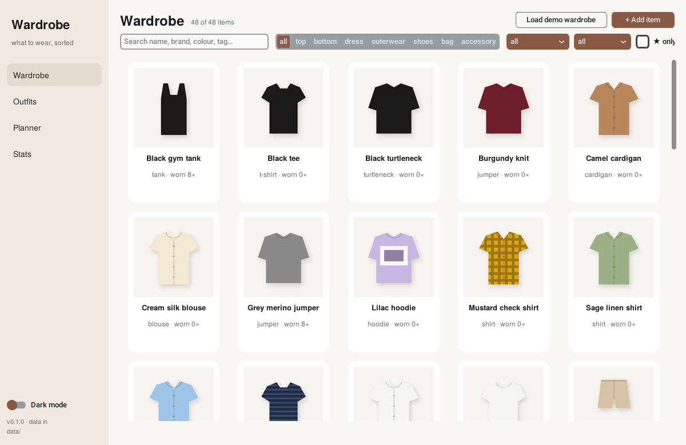
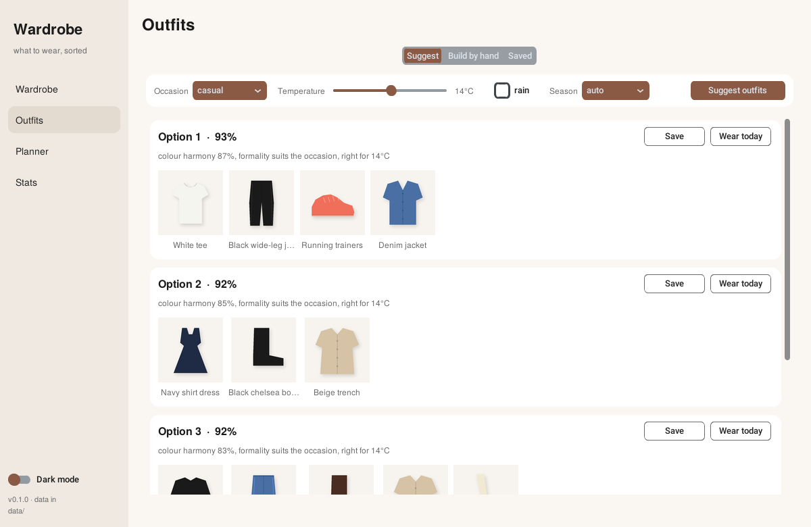
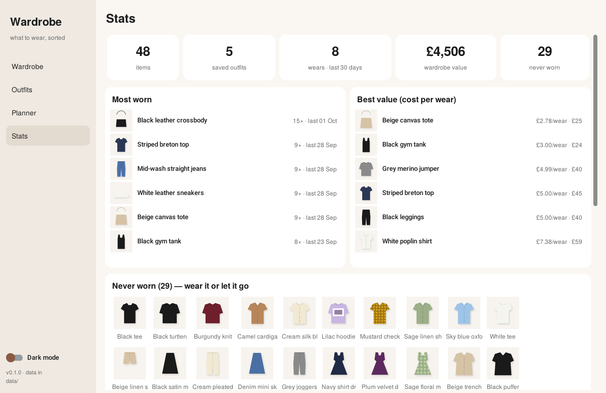

# Wardrobe

A desktop digital wardrobe and outfit planner. Catalogue your clothes, get outfit suggestions for the occasion and the weather, plan the week, and see what you actually wear.

Python + [customtkinter](https://github.com/TomSchimansky/CustomTkinter) + SQLite. No accounts, no cloud — the data lives in `data/` next to the app.



## Run it

```bash
git clone https://github.com/noorghamm/wardrobe.git
cd wardrobe
python3 -m venv .venv && source .venv/bin/activate
pip install -r requirements.txt
python -m wardrobe --demo        # --demo loads a 48-piece sample wardrobe the first time
```

macOS note: the Python from python.org (or `brew install python-tk`) includes Tkinter; the Xcode command-line-tools Python does not.

## What it does

**Wardrobe** — grid of everything you own with search and filters (category, season, laundry status, favourites). Click a card to edit: type, colour (palette or hex), pattern, seasons, formality and warmth sliders, brand, price, purchase date, tags, notes, photo. Import/export the whole wardrobe as CSV to bulk-edit in a spreadsheet.

**Outfits**
- *Suggest* — pick an occasion (casual, uni, work, date, party, formal, gym, travel), temperature and rain; it builds complete outfits (top + bottom or dress, shoes, outerwear when it's cold or wet, bag/accessory when they help) and ranks them. Each suggestion explains itself: colour harmony, formality fit, warmth, pattern clashes, and a nudge towards pieces you haven't worn lately.
- *Build by hand* — choose pieces per category, see them together and get the same score.
- *Saved* — your kept outfits. "Wear today" logs every piece as worn.



**Planner** — a week at a glance. Assign a saved outfit per day, or *Auto-fill* which generates a different outfit for each empty day (uni on weekdays, casual at the weekend). "Wore it" logs it for that date.

**Stats** — items, saved outfits, wears in the last 30 days, wardrobe value, most-worn pieces, best cost-per-wear, never-worn and not-worn-in-90-days lists, colour and category breakdowns.



Dark mode is a switch in the sidebar.

## About the pictures

Real photos come later — until then every item gets a generated flat-lay illustration in its own colour and pattern (`wardrobe/images.py` draws them with Pillow). When you add a photo through the edit dialog it replaces the illustration; photos are copied to `data/images/user/`.

## How suggestions are scored

`wardrobe/logic/outfits.py` — score = 0.40 × colour harmony + 0.25 × formality fit + 0.20 × warmth-for-the-weather + 0.10 × pattern sanity + 0.05 × freshness.

- Colour harmony (`logic/colours.py`): neutrals pair with anything; chromatic colours are compared on the hue wheel — analogous (≤45°) and complementary (~180°) score well, 60–100° apart scores badly. Light/dark contrast between neutrals is rewarded.
- Formality: each occasion has a band (e.g. work 3–4, formal 4–5). Main layers must sit in the band; shoes and bags get one step of slack. A wide spread inside one outfit is penalised.
- Warmth: the temperature maps to a target warmth 1–5; the outfit's heaviest layer should match. Below 10 °C without outerwear, and open shoes in rain, are penalised.
- Gym kit (tagged `gym`/`sport`) only appears for gym; lounge pieces only for casual/travel.
- Results are made varied: each option shares no main layer with the ones above it.

## Layout

```
wardrobe/
  models.py        dataclasses + the category / season / occasion vocab
  db.py            SQLite repository (items, outfits, wear log, weekly plan)
  images.py        placeholder illustrations
  seed.py          demo wardrobe
  csvio.py         CSV import/export
  logic/colours.py colour maths and harmony scoring
  logic/outfits.py suggestion engine
  logic/stats.py   wardrobe statistics
  ui/              customtkinter views: app, wardrobe, item_dialog, outfits, planner, stats, widgets
tests/             pytest — run `python -m pytest`
```

## Ideas for later

Weather from an API for the planner · packing lists for trips · outfit photos · "capsule" analysis (which pieces combine with the most others) · share an outfit as an image.
